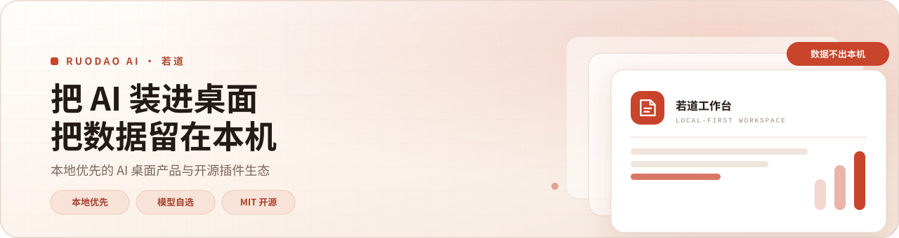
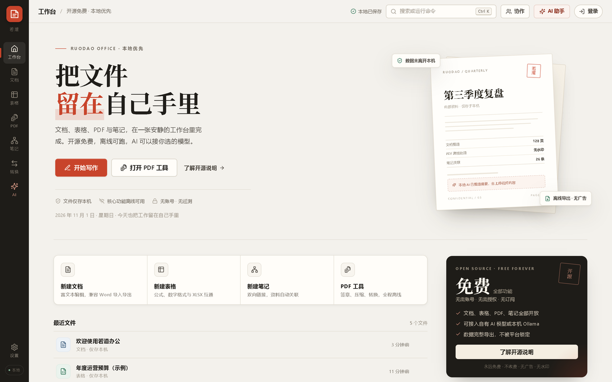
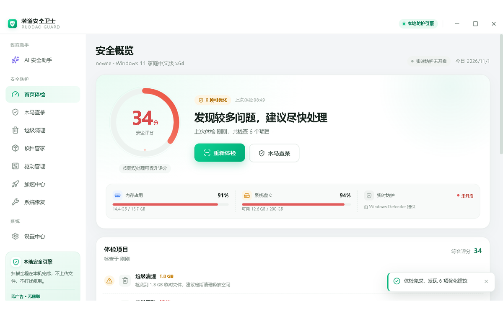
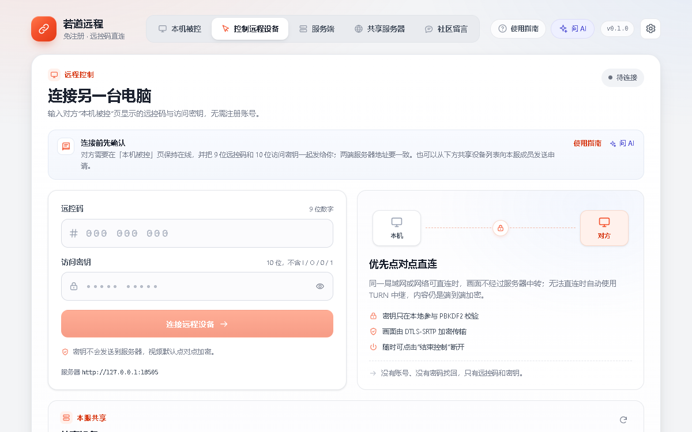
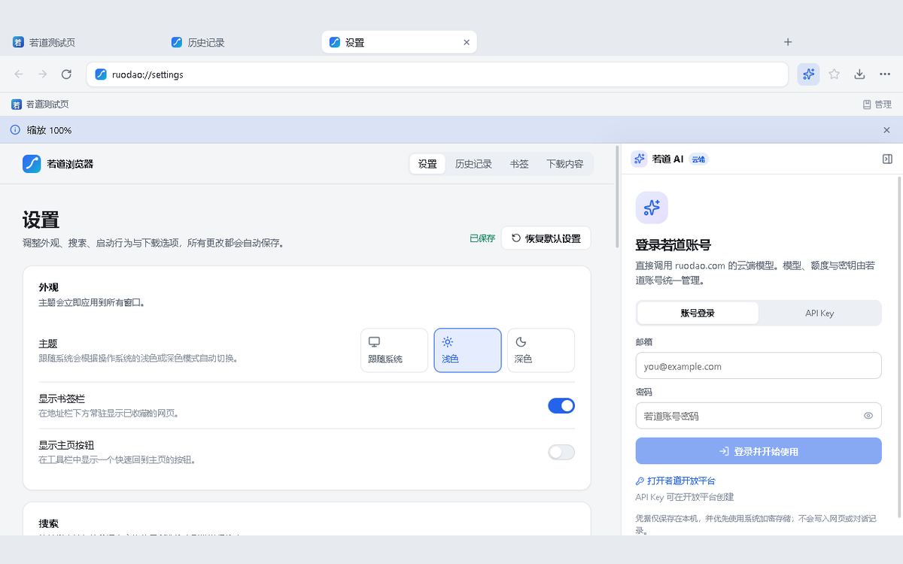

<picture>
  <source media="(max-width: 500px) and (prefers-color-scheme: dark)" srcset="assets/banner-mobile-dark.svg">
  <source media="(max-width: 500px)" srcset="assets/banner-mobile-light.svg">
  <source media="(prefers-color-scheme: dark)" srcset="assets/banner-dark.svg">
  
</picture>

 
 

**AI on your desktop, data on your machine.**

Local-first Windows desktop products and an open-source plugin ecosystem.

[Website](https://ruodao.com) &nbsp;·&nbsp; [Plugin Market](https://ruodao.com/plugin-market) &nbsp;·&nbsp; [Open Source](https://ruodao.com/open-source) &nbsp;·&nbsp; [简体中文](README.md)

 &nbsp;
 &nbsp;
 &nbsp;

---

## What we believe

|  |  |  |
| :---: | :---: | :---: |
| **Local-first** | **Your model** | **Open source** |
| Documents, recordings and history live in a local database and work offline. No accounts, nothing uploaded. | Use your own API key or local Ollama; content only reaches the service you pick. | Every repo is MIT licensed with no hidden cloud dependency. |

## Flagship products

| Product | Preview |
| :--- | :---: |
|  **Ruodao Office** 若道办公  Docs, sheets, a PDF toolbox, linked notes and batch format conversion in one quiet workspace. Bilingual UI, no paywalled export.  `Windows 10/11` &nbsp; `MIT`  [Repository](https://github.com/ruodaoai/ruodao-office) &nbsp;·&nbsp; [Download](https://github.com/ruodaoai/ruodao-office/releases/latest) |  |
|  **Ruodao Guard** 若道安全卫士  System health check, malware scanning, junk cleanup, software manager, driver management, speed center and system repair. No kernel driver, no background daemon.  `Windows 10/11` &nbsp; `MIT`  [Repository](https://github.com/ruodaoai/ruodao-guard-desktop) &nbsp;·&nbsp; [Download](https://github.com/ruodaoai/ruodao-guard-desktop/releases/latest) |  |
|  **Ruodao Remote** 若道远程  Account-free remote desktop for Windows: a 9-digit code plus a 10-character key, end-to-end encrypted WebRTC, with self-hosted signaling and shared servers.  `Windows 10/11` &nbsp; `MIT`  [Repository](https://github.com/ruodaoai/ruodao-remote) &nbsp;·&nbsp; [Download](https://github.com/ruodaoai/ruodao-remote/releases/latest) |  |
|  **Ruodao Browser** 若道浏览器  An AI desktop browser built on Electron and Chromium, with the Ruodao AI sidebar for summarizing, explaining, translating and rewriting the page you are on, plus isolated multi-profile environments.  `Windows 10/11` &nbsp; `MIT`  [Repository](https://github.com/ruodaoai/ruodao-browser) &nbsp;·&nbsp; [Download](https://github.com/ruodaoai/ruodao-browser/releases/latest) |  |

## Plugin ecosystem

Twelve official plugins that install straight into Ruodao Desktop. Each one is open source on its own.

| Plugin | What it does |
| :--- | :--- |
| [Meeting Assistant](https://github.com/ruodaoai/meeting-assistant) | Dual-channel live transcription, speaker detection, AI meeting participation and Markdown minutes |
| [Interview Assistant](https://github.com/ruodaoai/interview-assistant) | Live question listening with spoken answers, mock interviews, resume polishing with 29 templates, auto-apply on four job platforms |
| [Office Suite](https://github.com/ruodaoai/office-suite) | Word editing, Excel formula evaluation, PPT theme generation, PDF to Word, image compression and watermarking |
| [Flagship Router](https://github.com/ruodaoai/flagship-router) | One-click local OpenAI-compatible gateway that creates a key and plugs free models into the Ruodao agent |
| [Local ASR](https://github.com/ruodaoai/local-asr) | One-click OpenAI-compatible local speech recognition (faster-whisper / FunASR Paraformer); recordings never leave the machine |
| [TV Player](https://github.com/ruodaoai/tv-player) | Concurrent search across AppleCMS sources, multi-route parsing and grouped m3u live channels |
| [Music Player](https://github.com/ruodaoai/music-player) | Kugou search, playback, lyrics, charts and playlists through a local MoeKoe API |
| [Music Plaza](https://github.com/ruodaoai/music-plaza) | Dozens of music sources via musicdl, audiobook episodes, playlist parsing and proxied download |
| [Handraw Style](https://github.com/ruodaoai/handraw-style) | 366 hand-drawn styles × 167 diagram types × 36 monochrome palettes, with bilingual prompt assembly |
| [Image Pool](https://github.com/ruodaoai/image-pool) | VirtualBrowser plus FPBrowser2API in one: paste accounts into a pool, generate images directly, track usage |
| [Ruodao Guard · Plugin](https://github.com/ruodaoai/ruodao-guard) | Protection score, open malware signature scanning with Ed25519 verification, quarantine and hardening checks |
| [Remote Desk](https://github.com/ruodaoai/remote-desk) | Deploy RustDesk hbbs/hbbr on one Linux server and connect from desktop or phone by QR code |

## Tech stack

## Get started

| Desktop product | Install |
| :--- | :--- |
| Ruodao Office | [Latest release](https://github.com/ruodaoai/ruodao-office/releases/latest) (installer or portable) |
| Ruodao Guard | [Latest release](https://github.com/ruodaoai/ruodao-guard-desktop/releases/latest) |
| Ruodao Remote | [Latest release](https://github.com/ruodaoai/ruodao-remote/releases/latest) |
| Ruodao Browser | [Latest release](https://github.com/ruodaoai/ruodao-browser/releases/latest) |

Building from source? Every repository README has the full local setup: `git clone` → `npm install` → `npm run dev`.

## Contact

- Website and docs: <https://ruodao.com>
- Plugin market: <https://ruodao.com/plugin-market>
- Questions and ideas: Issues on any repository
- Security issues: follow the `SECURITY.md` in the relevant repository

 
Ruodao AI · 若道 — AI on your desktop, data on your machine 
Code under MIT License · © 2026 Ruodao AI

