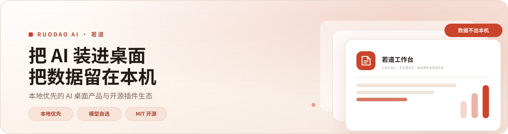
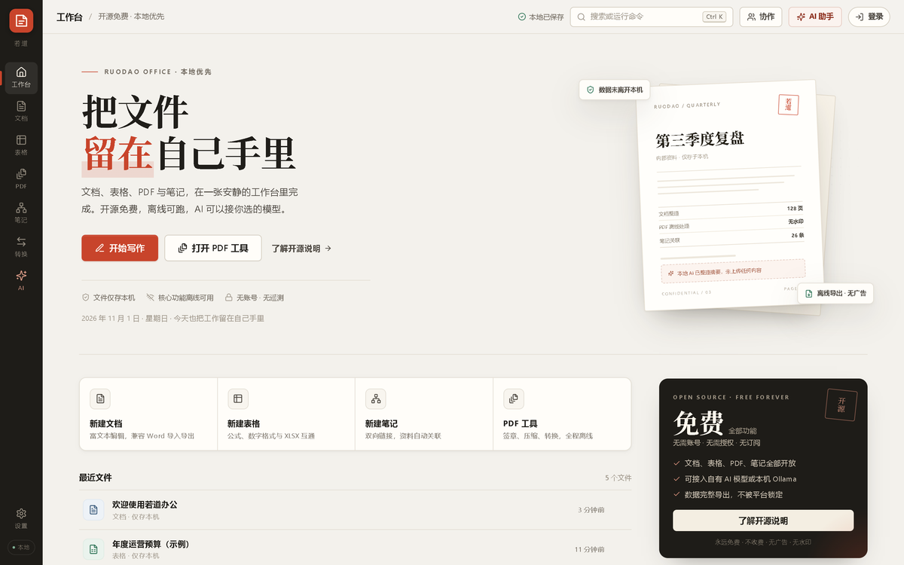
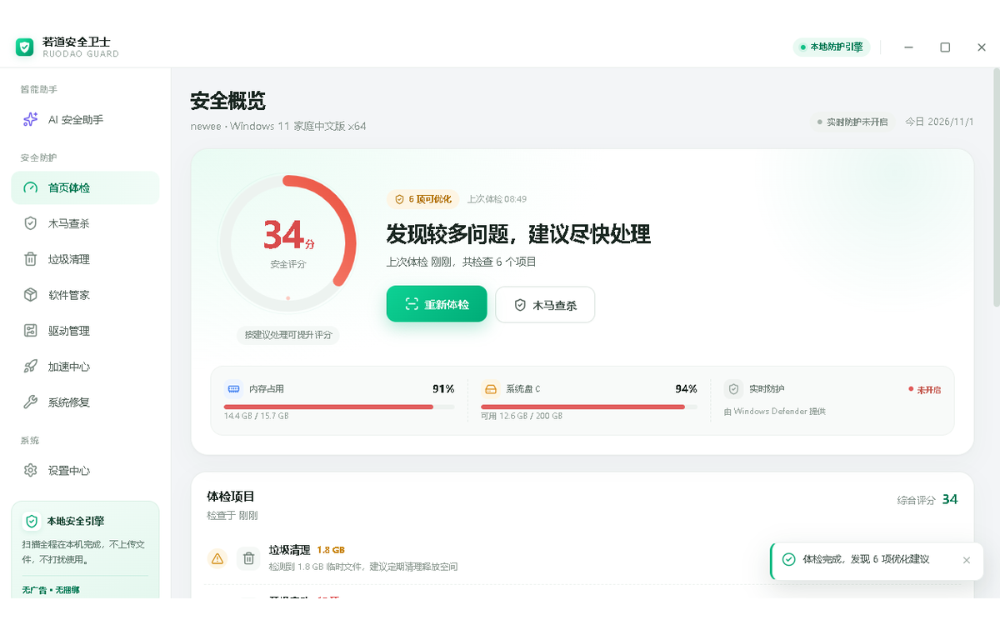
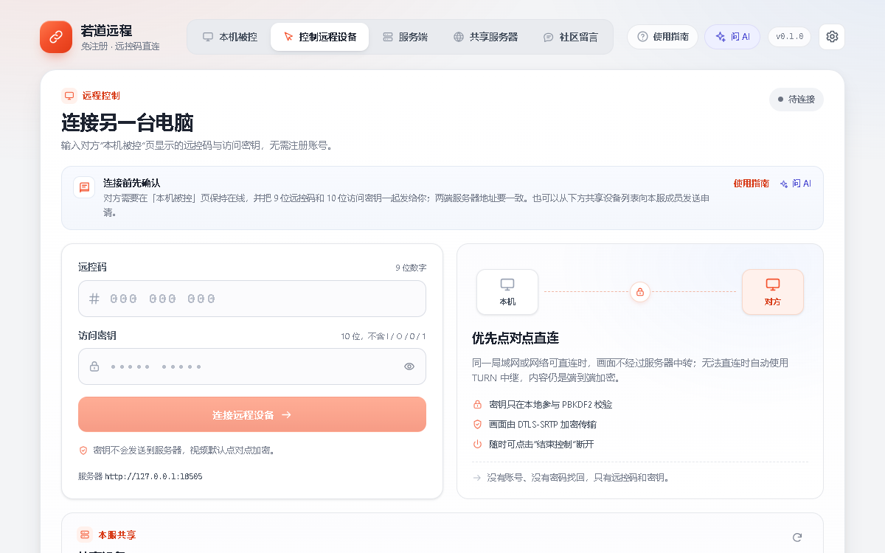
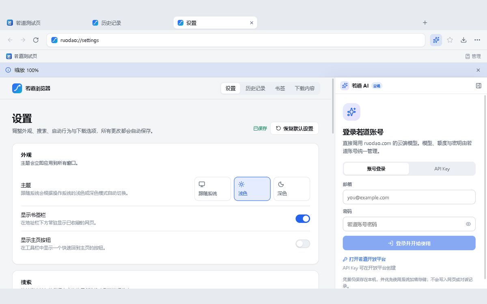

<picture>
  <source media="(prefers-color-scheme: dark)" srcset="assets/banner-dark.svg">
  
</picture>

 
 

**把 AI 装进桌面，把数据留在本机。**

本地优先的 Windows 桌面产品与开源插件生态。

[官网](https://ruodao.com) &nbsp;·&nbsp; [插件市场](https://ruodao.com/plugin-market) &nbsp;·&nbsp; [开源项目](https://ruodao.com/open-source) &nbsp;·&nbsp; [English](README.en.md)

 &nbsp;
 &nbsp;
 &nbsp;

---

## 我们相信

<table width="100%">
<tr>
<td width="33%" valign="top">

<h3>数据留在本机</h3>

文档、录音、浏览记录默认写入本地数据库，断网也能用。没有账号体系，也没有“已同步到云端”。

</td>
<td width="33%" valign="top">

<h3>模型由你指定</h3>

自带 API Key，或接本机 Ollama。内容只发往你选定的服务，不经过若道的服务器。

</td>
<td width="33%" valign="top">

<h3>开源可审计</h3>

全部仓库以 MIT 开源，没有隐藏的云端依赖，安全相关逻辑可逐行核对。

</td>
</tr>
</table>

## 旗舰产品

<table width="100%">
<thead>
<tr>
<th width="56%" align="left">产品</th>
<th width="44%" align="center">界面</th>
</tr>
</thead>
<tbody>
<tr>
<td width="56%" valign="middle">
<h3>若道办公 Ruodao Office</h3>

文档、表格、PDF 工具箱、双链笔记与格式转换，收进一个安静的工作台。中英双语，导出不二次收费。

<code>Windows 10/11</code> &nbsp; <code>MIT</code>

<a href="https://github.com/ruodaoai/ruodao-office">仓库</a> &nbsp;·&nbsp; <a href="https://github.com/ruodaoai/ruodao-office/releases/latest">下载</a>

</td>
<td width="44%" valign="middle">

</td>
</tr>
<tr>
<td width="56%" valign="middle">
<h3>若道安全卫士 Ruodao Guard</h3>

电脑体检、木马查杀、垃圾清理、软件管家、驱动管理、加速中心与系统修复。不装驱动、不驻留后台。

<code>Windows 10/11</code> &nbsp; <code>MIT</code>

<a href="https://github.com/ruodaoai/ruodao-guard-desktop">仓库</a> &nbsp;·&nbsp; <a href="https://github.com/ruodaoai/ruodao-guard-desktop/releases/latest">下载</a>

</td>
<td width="44%" valign="middle">

</td>
</tr>
<tr>
<td width="56%" valign="middle">
<h3>若道远程 Ruodao Remote</h3>

免注册的 Windows 桌面远控：9 位遥控码 + 10 位密钥，端到端加密 WebRTC，可自建信令服务与共享服务器。

<code>Windows 10/11</code> &nbsp; <code>MIT</code>

<a href="https://github.com/ruodaoai/ruodao-remote">仓库</a> &nbsp;·&nbsp; <a href="https://github.com/ruodaoai/ruodao-remote/releases/latest">下载</a>

</td>
<td width="44%" valign="middle">

</td>
</tr>
<tr>
<td width="56%" valign="middle">
<h3>若道浏览器 Ruodao Browser</h3>

基于 Electron 与 Chromium 的 AI 桌面浏览器，内置若道 AI 侧边栏：总结、解释、翻译、改写当前网页，支持独立多开环境。

<code>Windows 10/11</code> &nbsp; <code>MIT</code>

<a href="https://github.com/ruodaoai/ruodao-browser">仓库</a> &nbsp;·&nbsp; <a href="https://github.com/ruodaoai/ruodao-browser/releases/latest">下载</a>

</td>
<td width="44%" valign="middle">

</td>
</tr>
</tbody>
</table>

## 插件生态

12 个官方插件，装进若道桌面端即可使用，源码各自独立开源。

| 插件 | 能力 |
| :--- | :--- |
| [会议助手](https://github.com/ruodaoai/meeting-assistant) | 双通道实时转写、说话人识别、AI 参会发言、会议知识库与 Markdown 纪要 |
| [面试求职助手](https://github.com/ruodaoai/interview-assistant) | 双轨听题实时口语答案、AI 模拟面试、简历润色与 29 套模板、四平台自动投递 |
| [Office 办公套件](https://github.com/ruodaoai/office-suite) | Word 富文本、Excel 公式求值、PPT 主题生成、PDF 拆分转 Word、图片压缩加水印 |
| [免费模型网关](https://github.com/ruodaoai/flagship-router) | 一键装好本地 OpenAI 兼容网关，自动建 Key，把免费模型接入若道 Agent |
| [本地转写引擎](https://github.com/ruodaoai/local-asr) | 一键安装本地 ASR（OpenAI 兼容接口，faster-whisper / FunASR Paraformer），录音不出本机 |
| [影视播放器](https://github.com/ruodaoai/tv-player) | 苹果CMS 点播源多站并发搜索、多线路解析、m3u 直播分组播放 |
| [音乐播放器](https://github.com/ruodaoai/music-player) | 借道本机 MoeKoe 本地 API，取酷狗搜索、点播、歌词、榜单与歌单 |
| [音乐广场](https://github.com/ruodaoai/music-plaza) | 基于 musicdl 聚合几十个音源并发搜索、有声书分集、歌单解析与代理下载 |
| [手绘风画廊](https://github.com/ruodaoai/handraw-style) | 366 种手绘风格 × 167 种图型 × 36 款单色，中英双语提示词自动组装 |
| [生图号池](https://github.com/ruodaoai/image-pool) | VirtualBrowser + FPBrowser2API 二合一，账号自动入池、直驱生图、消耗统计 |
| [若道安全卫士 · 插件版](https://github.com/ruodaoai/ruodao-guard) | 防护评分、开放病毒库查杀（Ed25519 验签）、隔离区、系统加固体检与 AI 管家 |
| [远程控制](https://github.com/ruodaoai/remote-desk) | 一台 Linux 服务器一键部署 RustDesk hbbs/hbbr，本机与手机扫码接入 |

## 技术栈

## 快速开始

| 桌面产品 | 直接安装 |
| :--- | :--- |
| 若道办公 | [下载最新版](https://github.com/ruodaoai/ruodao-office/releases/latest)（安装版 / 免安装版） |
| 若道安全卫士 | [下载最新版](https://github.com/ruodaoai/ruodao-guard-desktop/releases/latest) |
| 若道远程 | [下载最新版](https://github.com/ruodaoai/ruodao-remote/releases/latest) |
| 若道浏览器 | [下载最新版](https://github.com/ruodaoai/ruodao-browser/releases/latest) |

想从源码构建？每个仓库的 README 都写了完整的本地运行步骤：`git clone` → `npm install` → `npm run dev`。

## 联系我们

- 产品官网与文档：<https://ruodao.com>
- 插件市场：<https://ruodao.com/plugin-market>
- 问题与建议：任意仓库的 Issues
- 安全问题：请按各仓库 `SECURITY.md` 的流程私下披露

 
若道 AI · Ruodao AI — 把 AI 装进桌面，把数据留在本机 
Code under MIT License · © 2026 Ruodao AI

